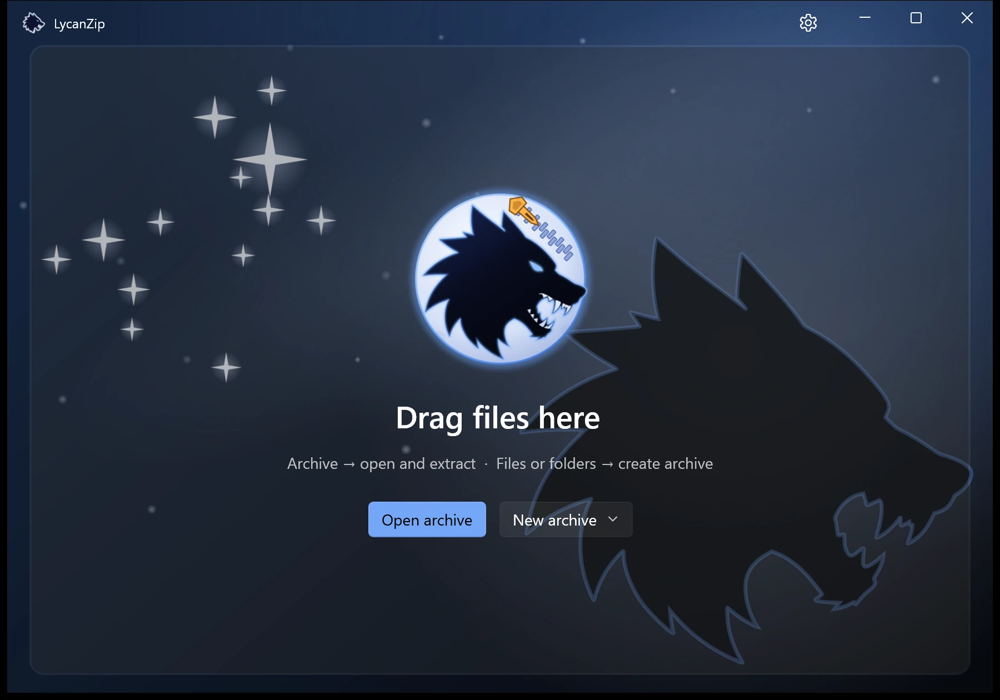
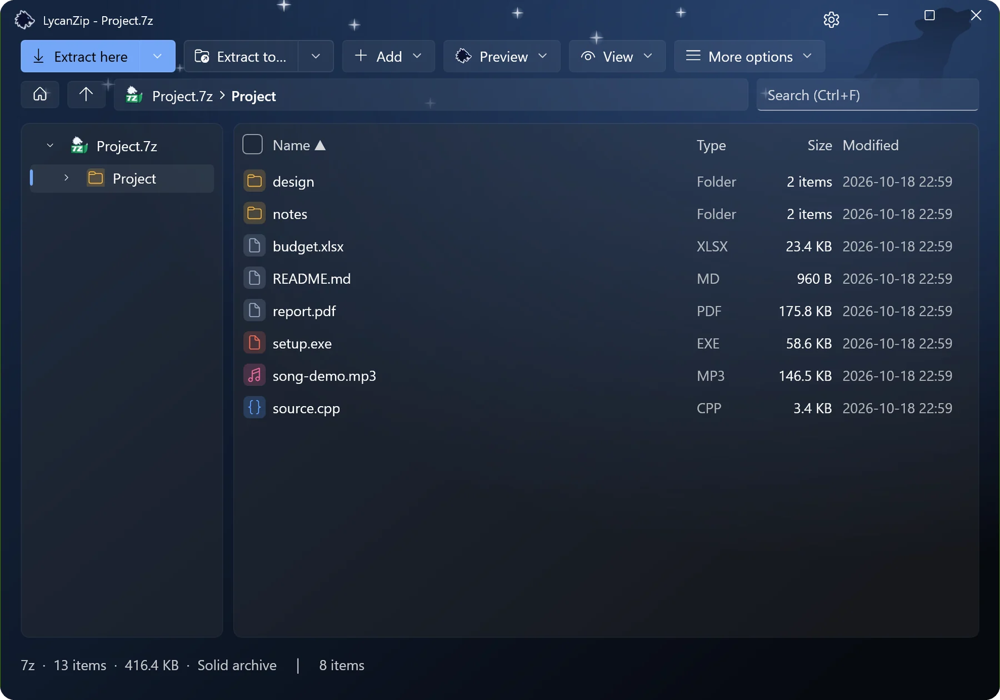
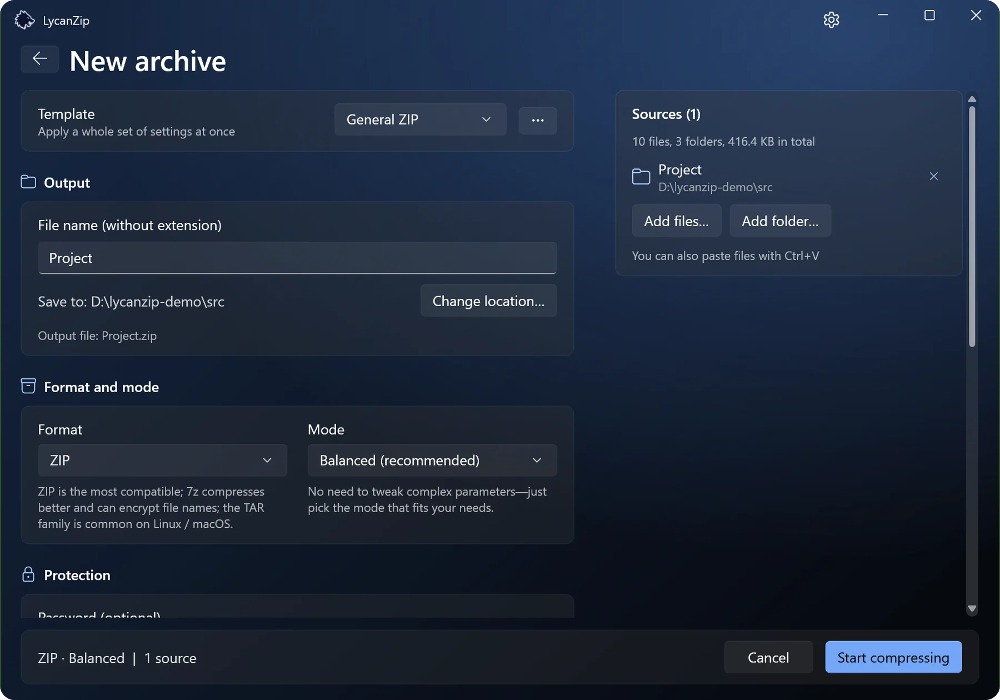

# LycanZip

A light, free and open source file archiver for Windows 10 and 11. No ads, no bundled software, no telemetry.

LycanZip opens and creates zip, 7z and tar archives, shows pictures and plays music inside an archive without unpacking it, and fits into the Explorer menu. The packing and unpacking is done by the [7-Zip](https://www.7-zip.org/) engine (`7z.dll`); the window is WinUI 3.

Web site and downloads: <https://aegisulf.com/lycanzip/>

**Status: version 1.0.** Version numbers follow [semantic versioning](https://semver.org/): the settings files (`settings.ini`, `presets.ini`) and the command line stay compatible within a major version. What changed is in [CHANGELOG.md](CHANGELOG.md).

## Get LycanZip

| | |
|---|---|
| **Microsoft Store** | [LycanZip in the Store](https://apps.microsoft.com/detail/9PB97QFZM56W): updated by Windows, and the only version with the entries in the new top-level Windows 11 menu (Windows lets only a signed package add them). |
| **Installer** | One click, per user, no administrator rights; can update itself (off until you switch it on). |
| **Zip / portable** | Unpack and run; the portable zip keeps its settings next to the program (a USB stick). |

Only the Store version is code-signed (by the Store); for the others, check the SHA-256 shown on the download page against your download. One copy is enough: when the Store version is installed it provides the right-click menu and the file types, and the other versions switch their own off.

| Home | Browsing an archive |
|---|---|
|  |  |
| **Picture preview** | **Creating an archive** |
|  |  |

## Features

**Open and browse**
- zip, 7z, rar (extract only), tar, gz, xz, bz2, iso, cab and many more (everything 7-Zip opens), including split archives (`.7z.001`, `.part1.rar`, `.z01`) and double-layer formats such as `.tar.gz` (opened as one tar).
- Folder tree, breadcrumb, details / list / icon views, search, check boxes, band selection.
- Picture preview with a thumbnail strip, EXIF orientation and animated GIF / WebP; audio player with tags and technical information. Pictures can be saved in another format and set as the desktop picture.
- File names of old zip / tar archives (Big5, GBK, Shift-JIS, EUC-KR, UTF-8) are detected automatically, and you can choose the encoding yourself.
- Passwords: AES-256 zip, 7z with encrypted file names; a wrong password is asked again before anything is extracted.

**Create and change**
- zip, 7z, tar, tar.gz, tar.xz, tar.bz2 and iso; presets, levels, solid blocks, split volumes, AES-256, encrypted file names in 7z, checksum files written next to the archive.
- Add, delete, rename and replace items inside zip, 7z and tar archives, with a safe temporary copy and an optional backup.

**Extract**
- Smart extraction (one root folder goes in directly, several items get a folder named like the archive), conflict handling per file, drag out to Explorer (also from solid 7z archives, in one pass), extract only the selection.

**Checksums**
- CRC32, MD5, SHA-1, SHA-256, SHA-384, SHA-512 for files, folders and the content of archives; verify `.sha256` / `.md5` / `.sfv` files.
- "Look up on VirusTotal" opens the page of the SHA-256 of an archive, or of a file in it, in your browser (only the hash is in the address; nothing is uploaded).

**Safety**
- Unsafe paths (`..`, absolute paths, drive letters, NTFS streams, reserved names) are refused, symbolic links are not followed, decompression bombs are caught, the Mark-of-the-Web of the archive is passed on, and archives can be scanned by the installed antivirus (AMSI).
- Nothing is collected. The only network request is an optional check for a new version, off by default.

**Windows integration**
- Explorer context menu (classic and the new Windows 11 menu), right-drag menu, file associations (registered for the current user only, and only when you switch them on).
- Portable mode: a file `LycanZip.portable` next to the exe keeps all settings in the program folder.
- Interface languages: English, Traditional Chinese, Simplified Chinese.
- A command line tool, `lycanzip-cli.exe`.

## Build

Requirements: Visual Studio 2022 Build Tools (Desktop development with C++ and the Windows 11 SDK), CMake, Ninja, PowerShell, Python 3 (tests), and a copy of `7z.dll`.

```powershell
.\scripts\check-env.ps1         # checks the tools and tells what is missing
.\scripts\fetch-7zip.ps1        # downloads the 7-Zip interface headers (once); add -Binaries for 7z.dll
.\scripts\build.ps1 -Test       # builds the Core and the CLI and runs the unit tests (Debug by default)
.\build\debug\bin\lycanzip-cli.exe l archive.zip
```

The graphical program (WinUI 3):

```powershell
.\scripts\build-app.ps1 -Config Release   # the first time it restores the NuGet packages (app\restore.ps1), then builds the Core and the app
.\app\bin\Release\LycanZip.exe [archive]
```

The VS Build Tools do not ship the targets that connect the XAML compiler to a native project, so `app\LycanZip.vcxproj` hooks `MarkupCompilePass1/2` into the build itself (the comments there explain why and in which order).

`7z.dll` is looked for in this order: the environment variable `LYCAN_7Z_DLL`, next to the exe, `%ProgramFiles%\7-Zip`, the Scoop install place. The build copies it to the output folder when it finds one.

UI smoke tests (they operate real windows and need an interactive desktop; do not touch the mouse and keyboard while they run): `.\scripts\ui-smoke.ps1`

The installer, the zip packages and the Microsoft Store package are made by the release flow, which is not part of this repository; the builds are on the [releases page](https://github.com/Aegisulf/LycanZip/releases) and in the Store.

## Command line

```
lycanzip-cli a <archive> <inputs...> [-t zip|7z|tar|tgz|txz|tbz2|iso] [-p pw] [-l 0-9]
           [--profile compatible|balanced|smallest|fastest] [-v 50m] [--encrypt-names] [-y]
lycanzip-cli l <archive>                      lists the content
lycanzip-cli x <archive> [-o dir] [-p pw] [-y|-s|-r] [--smart|--no-smart]
lycanzip-cli t <archive> [-p pw]              tests the integrity
lycanzip-cli u <archive> <operations...>      changes an existing zip / 7z / tar
lycanzip-cli hash <files...> [-a sha256,...]  checksums;  verify <checksum files...> checks them
lycanzip-cli cat <archive> <index> [-p pw]    writes one item to stdout
common option: --encoding auto|utf8|big5|gbk|sjis|kr|oem|<code page>
```

Run `lycanzip-cli` without arguments for the complete list. Without `-o`, `x` extracts smartly next to the archive; with `-o` it puts the content exactly into that folder. `lycanzip-cli info` prints the version and the environment (please attach it to a bug report).

## Project layout

```
src/core/     the Core static library: 7z wrapper, archive model, extraction, compression, safety layer, settings
src/cli/      the command line front end
app/          the WinUI 3 graphical program (C++/WinRT + XAML), with its language files in app/Assets/Lang
shellext/     the context-menu DLL of File Explorer (classic menu, right-drag menu, Windows 11 menu)
tests/        unit tests and the end-to-end test of the CLI
scripts/      build and test scripts
tools/        helper scripts (language files, sounds)
assets/       logo and icon sources
```

## License

The code of LycanZip is under the [MIT license](LICENSE). The licenses of 7-Zip and the other parts that are used are in [THIRD_PARTY.md](THIRD_PARTY.md).

## Support

LycanZip is made in spare time and stays free. Reports of problems are welcome in the [issues](https://github.com/Aegisulf/LycanZip/issues); if it saves you time, you can also support the project on [Ko-fi](https://ko-fi.com/aegisulf_lycan).
